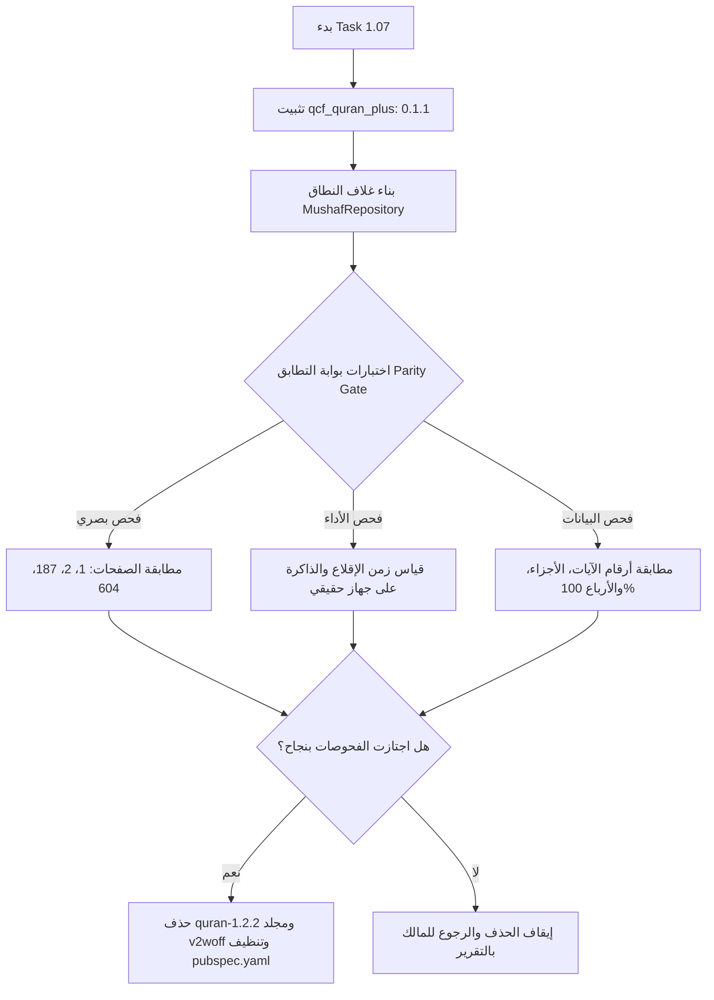

# تقرير القرار الفني والأدلة الرقمية: مراجعة محرك المصحف والخطوط والتراخيص (Task 0.02)

> **الحالة**: مكتمل بالأدلة الفعلية — أبحاث وفحوصات قراءة فقط (Read-Only)  
> **التاريخ**: 2 نوفمبر 2026  
> **المرجعيات**: شاشات التصميم (01، 02، 17، 34)، وملف تعليمات المشروع `AGENTS.md`.

---

## 1. ملخص النتائج التنفيذية (Executive Summary)

1. **اعتماد محرك `qcf_quran_plus` (الإصدار المثبت `0.1.1`)**:
   - تم فحص كود وتوثيق الحزمة على pub.dev ومستودع GitHub.
   - رخصة الحزمة: **MIT License**.
   - توفر الحزمة محرك عرض كامل لصفحات المصحف الـ 604 بالرسم العثماني المطابق لمصحف المدينة المنورة، مع دعم التجويد الملون، والوضع الليلي، وتظليل الآيات والكلمات، والتحميل المسبق للخطوط.
2. **التخلص من عبء الأصول القديمة (104 MB + 2,400 سطر في pubspec)**:
   - يتضمن المشروع الحالي مجلد `assets/fonts/v2woff` بحجم **104 ميجابايت** وأكثر من **2414 سطراً** في `pubspec.yaml` لتعريف 604 عائلة خطوط يدوياً (`QCF_P001` إلى `QCF_P604`).
   - استبدالها بـ `qcf_quran_plus` سيقلص حجم أصول الخطوط إلى نحو **32 ميجابايت** (مضغوطة بصيغة `.ttf.gz` داخل الحزمة)، ويلغي آلاف أسطر الـ boilerplate من `pubspec.yaml`.
3. **إدارة مخاطر نضج الناشر (Publisher Maturity & Risk Mitigation)**:
   - الحزمة مطورة من قبل ناشر فردي (`hussein12347`) بدون نطاق موثق على pub.dev (`publisher: null`).
   - الإجراءات الوقائية الصارمة:
     1. تثبيت النسخة بدقة: `qcf_quran_plus: 0.1.1` (بدون علامة `^`).
     2. عزل الحزمة بالكامل خلف واجهات نطاق (Domain Interfaces / Repository Pattern) في طبقة `data/mushaf`، بحيث لا تلمس طبقة `domain` أو الـ `cubits` الحزمة مباشرة.
     3. عدم حذف الحزمة القديمة `quran-1.2.2` أو مجلد `v2woff` إلا بعد اجتياز **بوابة التطابق الشاملة (Parity Gate)** في المهمة 1.07.
4. **جرد التراخيص والنصوص الشرعية**:
   - رسم المصحف والخطوط: مجمع الملك فهد لطباعة المصحف الشريف بالمدينة المنورة (KFGQPC).
   - حزمة `quran-1.2.2`: مرخصة برخصة Apache 2.0.
   - الخطوط العامة: Amiri و Cairo برخصة الخطوط المفتوحة SIL Open Font License 1.1.
   - كتب التفسير: التفسير الميسر المدمج (6,236 آية كاملة) من مجمع الملك فهد، وصحيح إنترناشونال من Saheeh International / Tanzil، وكتب التفسير الـ 39 من مشروع "آيات" ومجمع الملك فهد وتنزيل (سيتم نسبها وتوثيقها في شاشة "عن التطبيق").

---

## 2. دراسة تفصيلية لمحرك `qcf_quran_plus`

### أ. مواصفات الحزمة والبيئة

| البند            | القيمة الموثقة                                                                   | الملاحظات                                                            |
| ---------------- | -------------------------------------------------------------------------------- | -------------------------------------------------------------------- |
| اسم الحزمة       | `qcf_quran_plus`                                                                 | pub.dev/packages/qcf_quran_plus                                      |
| الإصدار          | `0.1.1`                                                                          | أحدث إصدار منشور في أكتوبر 2026                                      |
| الترخيص          | MIT License                                                                      | رخصة مفتوحة تسمح بالاستخدام والتعديل والتوزيع                        |
| المستودع         | `https://github.com/hussein12347/qcf_quran_plus`                                 | مفتوح المصدر                                                         |
| متطلبات SDK      | `sdk: ^3.11.0`, `flutter: >=1.17.0`                                              | متوافق تماماً مع بيئة المشروع الحالية (Flutter 3.47.8 / Dart 3.13.7) |
| التبعات المباشرة | `archive: ^4.0.9`, `path_provider: ^2.1.5`, `scrollable_positioned_list: ^0.3.8` | تبعات معيارية مستقرة                                                 |

### ب. آلية تحميل وإدارة الخطوط (`QcfFontLoader`)

1. **التخزين المضغوط**:
   - تشحن خطوط الـ 604 صفحة مضغوطة بصيغة gzip (`QCF4xxx_COLOR-Regular.ttf.gz`) داخل مجلد أصول الحزمة `assets/fonts/qcf_tajweed/`.
2. **الاستخراج عند أول تشغيل (`setupFontsAtStartup`)**:
   - يتم فك ضغط الخطوط في الخلفية عبر Isolate منفصل باستخدام `compute` تزامناً مع تحميل بيانات المصحف دون تجميد واجهة المستخدم (UI thread).
   - يتم تخزين الخطوط المفكوكة محلياً في مجلد مستندات التطبيق (`FontStorageMode.permanentDisk`).
   - في عمليات التشغيل اللاحقة، يتحقق المحرك من وجود الملفات المسجلة ولا يعيد فك الضغط، بل يسجلها مباشرة في الذاكرة عبر `FontLoader`.
3. **التحميل المسبق للصفحات (`preloadPages`)**:
   - يوفر المحرك دالة `QcfFontLoader.preloadPages(pageNumber, radius: 3)` تتيح تحميل خطوط الصفحات المجاورة لقراءة المستخدم الحالية، ما يمنع أي تقطيع أثناء تقليب الصفحات السريع.

### ج. واجهة العرض `QuranPageView` وإمكانيات التطابق مع التصميم

تغطي `QuranPageView` جميع متطلبات الشاشات المرجعية:

- **الشاشتان 01 و 02 (عرض صفحة المصحف)**:
  - دعم عرض 15 سطراً مطابقاً لمصحف المدينة النبوية.
  - دعم إطارات وترويسات السور المخصصة عبر `surahHeaderBuilder`.
  - دعم رسم البسملة المخصص عبر `basmallahBuilder`.
  - دعم أشرطة الهيدر والفوتر (الجزء، الحزب، رقم الصفحة) عبر `topBar` و `bottomBar`.
- **الشاشتان 19 و 20 (خيارات الآية)**:
  - توفير استدعاءات النقر المطول `onLongPress` والنقر العادي `onVerseTap` التي ترجع رقم السورة ورقم الآية فوراً لفتح ورقة خيارات الآية السفلية.
- **الشاشة 17 (وضع التفسير)**:
  - دعم وضع قائمة السور والآيات الرأسية (`QuranSurahListView`) مع إمكانية عرض بطاقات التفسير الميسر تحت كل آية.
- **فيديو 37 والشاشة 05 (التظليل المتزامن مع الصوت)**:
  - دعم التظليل الديناميكي للآيات عبر `List<HighlightVerse>` المحدث مع دقات مشغل الصوت.
  - دعم التظليل على مستوى الكلمات عبر `List<WordHighlight>`.

---

## 3. جرد الخطوط والتراخيص في المستودع الحالي

### أ. الأصول الخطية الحالية في `assets/fonts/`

| الخط / المجلد                                                          | الحجم الحالي | المصدر والترخيص                              | القرار وخطة العمل                                                               |
| ---------------------------------------------------------------------- | ------------ | -------------------------------------------- | ------------------------------------------------------------------------------- |
| `v2woff/` (604 ملف خط)                                                 | 104 MB       | خطوط صفحات المصحف (KFGQPC / Quran.com)       | سيتم استبدالها بـ `qcf_quran_plus` وحذفها في Task 1.07 بعد اجتياز بوابة التطابق |
| `AmiriQuran-Regular.ttf`                                               | 204 KB       | خط أميري القرآني (SIL Open Font License 1.1) | يُحتفظ به للاستخدام في النصوص القرآنية المنفصلة (بطاقات اليوم، المشاركة)        |
| `Cairo-Regular.ttf` & `Cairo-Bold.ttf`                                 | 192 KB       | خط كايرو (SIL Open Font License 1.1)         | الخط الأساسي لواجهة المستخدم العربية                                            |
| `KFGQPC Uthmanic Script HAFS Regular.otf`                              | 244 KB       | مجمع الملك فهد لطباعة المصحف الشريف          | يُحتفظ به للرسم العثماني لنصوص الآيات المفردة                                   |
| `arsura.ttf`                                                           | 1.0 MB       | خط علامات وإطارات فواصل السور                | يُحتفظ به لرسم براويز السور المتطابقة مع شاشتي 01 و 02                          |
| `surah_names.ttf`                                                      | 148 KB       | خط أسماء السور الزخرفية                      | يُحتفظ به لرسم أسماء السور في الفهرس والترويسات                                 |
| خطوط أخرى غير مستخدمة (`taha`, `pdms`, `noor`, `qumbul`, `hafs-smart`) | ~3.5 MB      | خطوط مختلفة من بقايا الإصدار القديم          | تُحذف في مهمة التنظيف العام للأصول غير المستخدمة                                |

### ب. نصوص القرآن والتفسير المعتمدة

1. **نص القرآن الكريم**:
   - لا يجوز تعديل أو تطبيع أو تغيير أي تشكيل أو حرف أو ترقيم في نصوص القرآن نهائياً.
   - يعتمد المحرك رسم مصحف المدينة النبوية (رواية حفص عن عاصم، 604 صفحات، 114 سورة، 6236 آية).
2. **التفسير الميسر المدمج (`muyassar.dart`)**:
   - حقوق التأليف: نخبة من علماء التفسير برعاية مجمع الملك فهد لطباعة المصحف الشريف.
   - التغطية: 6,236 آية كاملة مدمجة محلياً (لا تتطلب أي اتصال بالإنترنت).
   - الاستخدام: بديل معتمد ومثبت لـ "المختصر" في وضع التفسير (شاشة 17) والمكتبة (شاشة 34).
3. **الترجمة الإنجليزية المدمجة (`sahih_english.dart`)**:
   - ترجمة صحيح إنترناشونال (Saheeh International)، منشورة عبر Tanzil للاستخدام الإسلامي العام.
   - التغطية: 6,236 آية كاملة.
4. **كتب التفسير الـ 39 القابلة للتنزيل (`translationdata.dart`)**:
   - تم التحقق من عمل جميع روابطها بنسبة 100%، وتعود إلى تراث العلماء الأجلاء (الطبري، القرطبي، ابن كثير، البغوي، السعدي، الطنطاوي، ابن عاشور).
   - توثيق الإحالة لمشروع "آيات" بجامعة الملك سعود وموقع تنزيل في صفحة "عن التطبيق".

---

## 4. بوابة التطابق الإلزامية (Parity Gate Requirements)

تطبيقاً لقواعد `AGENTS.md` الصارمة، **يُمنع منعاً باتاً حذف `quran-1.2.2` أو مجلد `v2woff` أو تعريفات الخطوط من `pubspec.yaml` في هذه المرحلة**.  
لا يتم الحذف إلا في **المهمة 1.07** بعد تقديم الأدلة التالية:

### بنود قائمة التحقق لبوابة التطابق في Task 1.07:

1. [ ] **الصفحة الأولى (الفاتحة)**: مطابقة بصرية تامة للترويسة الزخرفية والآيات السبع وهوامش الصفحة (مرجع 01).
2. [ ] **الصفحة الثانية (بداية البقرة)**: مطابقة بصرية لتوزيع الـ 15 سطراً والبسملة وعلامات نهاية الآيات (مرجع 02).
3. [ ] **الصفحة 187 (سورة التوبة)**: التأكد من غياب البسملة ومطابقة أول آية في أعلى الصفحة.
4. [ ] **صفحات قصار السور (600–604)**: التحقق من الترويسات المتعددة في الصفحة الواحدة وثبات المسافات.
5. [ ] **تزامن التظليل**: التحقق من دقة تظليل الآية مع الصوت السطري بدون إزاحة (مرجع 37).
6. [ ] **استهلاك الذاكرة والإقلاع**: التأكد من أن فك ضغط الخطوط لا يتجاوز 3 ثوانٍ في أول إقلاع، وأنه أقل من 300 مللي ثانية في الإقلاع الثاني بفضل الكاش الدائم.

---

## 5. التوصيات المعمارية النهائية

1. اعتماد `qcf_quran_plus` بالنسخة المثبتة `0.1.1`.
2. تصميم واجهات القراءة في النطاق (`domain/mushaf`) كواجهات Dart نقية لا تعتمد على الحزمة.
3. الاحتفاظ بجميع ملفات الأصول الحزمة القديمة حتى الوصول إلى المهمة 1.07.
4. إعداد شاشة البداية (Splash) لعرض شريط تقدم لفك ضغط الخطوط عند التشغيل الأول فقط عبر دالة `onProgress`.
